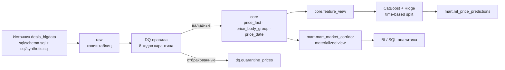

# Smart Logistics — аналитика рыночных ставок и прогнозирование тарифов

Прототип платформы данных для B2B-сервиса грузоперевозок: очистка операционных данных о сделках, построение витрины «карточка маршрута и рыночный коридор ставок» и ML-прогноз справедливого тарифа с сохранением результата в БД.

Всё разворачивается одной командой и не требует ручных шагов — ни копирования `.env`, ни отдельной сборки образов:

```bash
docker compose up
```

Команда собирает образы, поднимает PostgreSQL 17, инициализирует источник (300 000 сделок), применяет миграции, прогоняет ETL, пересчитывает витрину, обучает модель, выполняет пакетный скоринг и проверяет полноту слоёв. Оркестрация — Apache Airflow, один прогон DAG (`smart_logistics_pipeline`) запускается автоматически и блокирует сервис `bootstrap` до завершения.

Инициализация источника, DDL хранилища и подготовка метаданных Airflow выполняются одноразовым сервисом `airflow-init` — в регулярный DAG они не входят, иначе каждый плановый прогон пересоздавал бы витрину.

`.env` опционален: значения по умолчанию заданы в `docker-compose.yml` (якорь `x-app-env`) и являются единственным их источником — Python их не дублирует. `.env.example` нужен только чтобы эти значения переопределить. Нужен Docker Compose v2 (используются якоря YAML и `depends_on` с условиями).

| Что | Где |
| :--- | :--- |
| Airflow UI | http://localhost:8080 (логин `admin` / пароль `admin`) |
| PostgreSQL | `localhost:5432`, БД `deals_bigdata` |
| Модель и метрики | `./artifacts/catboost_price.cbm`, `./artifacts/ml_metrics.json` |
| Логи задач Airflow | `./logs` |

Первичная инициализация на чистом окружении занимает около 3–4 минут: сборка трёх образов, генерация 300 000 сделок (~40 секунд), DDL и метаданные Airflow, засев истории (~30 секунд) и прогон DAG. Повторный `docker compose up` на уже заполненном томе — около 2 минут: образы не пересобираются, но ETL (окно `ETL_WINDOW_DAYS`), витрина и ML отрабатывают заново; шаги идемпотентны, поэтому данные не меняются. Время зависит от CPU и диска — ML-часть самая чувствительная к ресурсам.

---

## Содержание

1. [Архитектура](#архитектура)
2. [Слои данных](#слои-данных)
3. [ETL и качество данных](#etl-и-качество-данных)
4. [Аналитическая витрина](#аналитическая-витрина)
5. [ML-контур](#ml-контур)
6. [Оркестрация](#оркестрация)
7. [Конфигурация](#конфигурация)
8. [Проверка результата (SQL)](#проверка-результата-sql)
9. [Тесты](#тесты)
10. [Допущения и трактовки ТЗ](#допущения-и-трактовки-тз)
11. [Известные ограничения](#известные-ограничения)
12. [Что вне скоупа](#что-вне-скоупа)
13. [Структура репозитория](#структура-репозитория)

Исходный текст задания сохранён в [docs/task-description.md](docs/task-description.md).

---

## Архитектура



**Обоснование стека.**

- **PostgreSQL 17** — обязательное требование; здесь же живут и источник, и хранилище (разные схемы). Отдельная СУБД для источника не нужна: данные в него генерируются тем же `docker compose up`.
- **Materialized view вместо таблицы с инкрементальной загрузкой** — витрина целиком описывается одним SQL-запросом: нет отдельного загрузчика, который может разойтись с определением, идемпотентность `REFRESH` получается бесплатно, а `REFRESH … CONCURRENTLY` не блокирует читателей. На 300 тыс. сделок полный пересчёт занимает ~6 секунд.
- **CatBoost** — категориальные признаки (регион, город, кузов) без ручного кодирования, устойчивость к выбросам и лучшее качество на табличных данных (см. [метрики](#ml-контур)); Ridge оставлен как бейзлайн для сравнения.
- **Airflow** — шаги пайплайна требуют порядка, ретраев и наблюдаемости. Оркестратор тонкий: каждая задача — вызов того же CLI, что доступен руками, поэтому любой шаг воспроизводится без Airflow.

## Слои данных

| Схема | Назначение | Объекты |
| :--- | :--- | :--- |
| `public` | операционная БД `deals_bigdata` | таблицы источника (не наша зона ответственности) |
| `raw` | снимок источника | `prices`, `price_dates`, `price_body_types`, `cities`, `body_types`, `exchange_rates` |
| `core` | очищенные и нормализованные данные | `price_fact`, `price_body_group`, `price_date`, `cities_dedup` (view), `body_types` (view), `feature_view` (view) |
| `dq` | отбракованные строки | `quarantine_prices`, справочник `reason_codes` |
| `mart` | аналитический слой | `pipeline_params`, `mart_market_corridor` (MV), `ml_price_predictions` |

Ключевые решения по модели данных:

- **Дедупликация городов.** `cities.gc_id` не уникален (у Москвы и Казани есть по две строки с разными `id` и разным написанием). View `core.cities_dedup` берёт строку с минимальным `id` на `gc_id` и разбирает `full_name_local` на город и регион. Прямой `JOIN` без дедупликации размножил бы сделки.
- **Группы кузова.** `core.body_group_name(std_id)` сводит коды 1С к шести группам: `Тент` (56–61), `Рефрижератор` (4, 46–48), `Изотерм` (2), `Борт` (1, 15), `Прочие`, `Не указан` (NULL). Порядок разрешения: `price_body_types` → `prices.body_type` → «Не указан». Одна цена может попасть в две группы (тент + борт) — это разные ячейки витрины, но дубля внутри одной группы не бывает.
- **Помесячная развёртка.** Долгосрочная заявка имеет несколько строк `price_dates`, поэтому месяц витрины берётся из `price_dates.price_date`, а не из `loading_date`.
- **`price_group_id` не переносится в `core`.** Это ссылка на служебную статистику, посчитанную по сырой цене; использовать её в модели — прямая утечка.

## ETL и качество данных

Шаг `load` работает окном по `loading_date` (по умолчанию — вся история) и делает всё в одной транзакции: либо окно перезаписано целиком, либо не изменено.

**Правила отбраковки** (`etl/dq.py`). Применяются в фиксированном порядке, первое сработавшее определяет код — статистика отсева воспроизводима между прогонами.

| # | Код | Условие |
| :---: | :--- | :--- |
| 1 | `PRICE_NON_POSITIVE` | `price <= 0` |
| 2 | `DISTANCE_NON_POSITIVE` | `distance <= 0` или `NULL` |
| 3 | `NEGATIVE_WEIGHT` | `total_weight < 0` |
| 4 | `NEGATIVE_VOLUME` | `total_volume < 0` |
| 5 | `UNKNOWN_CITY` | города нет в `cities` |
| 6 | `UNSUPPORTED_CURRENCY` | валюта вне 643/840/978 |
| 7 | `MISSING_EXCHANGE_RATE` | валютная сделка без точного курса на `nearest_rate_date` |
| 8 | `PRICE_BELOW_RUB_FLOOR` | `price_rub <= 1000` |

**Конвертация валют.** Для 840/978 берётся курс ЦБ строго на `nearest_rate_date`; если строки курса на эту дату нет — карантин. Fallback на `loading_date` не используется (прямое требование ТЗ). Для 643 курс не запрашивается вовсе: цена уже в рублях, а `nearest_rate_date` у рублёвых строк в источнике может быть `NULL` — требовать его значило бы отбраковать ~2% нормальных сделок.

**Порог 1000 ₽.** Применяется к `price_rub` **после** конвертации и одинаково для всех валют: пятидолларовая сделка (≈450 ₽) — такой же мусор, как и рублёвая за 500 ₽. Подробнее — в [допущениях](#допущения-и-трактовки-тз).

**Категории.** `core.weight_category(weight)` и `core.volume_category(volume)` — доменные функции, единая точка правды для ETL, витрины и тестов. Вес округляется до 0.1 т: `G20T` ≥ 30, `FTL` [10; 30), `10T` [5; 10), `5T` [2.5; 5), `L5T` [0.5; 2.5), иначе `OTH`. Объём: `FTL` при `0 < V ≤ 120`, иначе `OTH`. Категории пересчитываются всем строкам, а не только `NULL` — иначе в одной витрине смешались бы две разные логики.

**Выбросы.** `outlier_mark` из источника — входной флаг, в ETL не пересчитывается. Такие строки **остаются** в `core` (они нужны для «факт vs прогноз»), но исключаются из витрины и из обучения модели.

**Идемпотентность.** Окно перезаписывается атомарно: `DELETE` + `INSERT` в одной транзакции, дочерние таблицы снимаются каскадом. Повторный запуск за тот же период не меняет ни количества строк, ни перцентилей.

**Фактические объёмы (300 000 сделок):**

| Показатель | Значение |
| :--- | ---: |
| Прочитано из источника | 300 000 |
| Загружено в `core.price_fact` | 299 797 |
| Отбраковано | 203 (`PRICE_NON_POSITIVE` — 164, `MISSING_EXCHANGE_RATE` — 39) |
| Строк `core.price_date` | 336 576 |
| Групп кузова | 335 077 |
| Время шага `load` | ~24 с |

### Пакетная загрузка и логирование

Загрузка не построчная. Валидные строки окна переносятся одним `INSERT … SELECT` из staging-таблицы, группы кузова, первичная группа и развёртка по месяцам — тоже set-based запросами; в Python нет циклов по строкам. Единственное место с `executemany` — запись прогнозов в `mart.ml_price_predictions` (около 18 тыс. строк). Дубли исключены ключами: `core.price_fact.price_id`, `(price_id, body_group)`, `(price_id, model_name)` для прогнозов.

Логи структурированные: одна JSON-строка на событие, со счётчиками и длительностью шага.

```json
{"ts": "2026-11-09T20:11:07+00:00", "level": "INFO", "event": "load:done", "rows_read": 2096, "rows_loaded": 2094, "rows_quarantined": 2, "quarantine_by_reason": {"PRICE_NON_POSITIVE": 2}, "duration_ms": 5130}
```

Уровень задаётся `LOG_LEVEL`; `check:settings` печатает параметры прогона без пароля.

## Аналитическая витрина

`mart.mart_market_corridor` — материализованное представление с зерном **месяц × город отправления × город назначения × группа кузова × весовая категория**.

**Фильтры выборки:** `is_fact`, `NOT complex`, `price_rub > 0`, `distance > 0`, `NOT outlier_mark`, `price_date <= as_of` (плановые месяцы из будущего не попадают в историю рынка; фильтр построчный — октябрьская ячейка остаётся, но только по датам до 26.10).

**Метрики:**

| Группа | Колонки |
| :--- | :--- |
| Коридор за рейс | `p25_trip`, `median_trip`, `p75_trip`, `avg_trip` |
| Коридор за км | `p25_km`, `median_km`, `p75_km` от `price_rub / distance` |
| Доказательная база | `trips_count`, `carriers_count` (только `price_type IN (3,9)`), `cv_rate` (`stddev_samp/avg`, `NULL` при < 2 наблюдениях) |
| Динамика | `mom_pct`, `yoy_pct` — только к календарному предыдущему месяцу / тому же месяцу год назад; при отсутствии ячейки `NULL`, «последний доступный» месяц не подставляется |
| Надёжность | `reliability_level`: `HIGH` при `trips_count ≥ 30`, `carriers_count ≥ 5` и месяце, пересекающемся с окном `[as_of − 30 дн; as_of]`; `MEDIUM` при `trips_count ≥ 10`; иначе `LOW_DATA` |
| Свежесть данных | `last_price_date` — максимальный `price_date` в ячейке. Справочная величина: показывает фактическую дату последней сделки, пока `reliability_level` оценивает актуальность месяца |

`MoM`/`YoY` считаются self-join'ом на календарный соседний месяц, а не `LAG`: при «дыре» в истории `LAG` подставил бы неверного соседа вместо `NULL`.

**Фактический результат и распределение надёжности:**

| Показатель | Значение |
| :--- | ---: |
| Ячеек витрины | 203 644 |
| `LOW_DATA` | 202 710 |
| `MEDIUM` | 924 |
| `HIGH` | 10 |
| Время `REFRESH … CONCURRENTLY` | ~6 с |

`HIGH` есть только у сентября и октября 2026 — прямое следствие правила свежести (см. допущения). Ячеек `HIGH` мало, потому что зерно очень мелкое: чтобы получить 30 рейсов и 5 перевозчиков в одной комбинации «маршрут × кузов × весовая категория» за один месяц, нужен действительно плотный поток.

## ML-контур

**Признаки** (`core.feature_view` + `ml/features.py`): 17 числовых и 7 категориальных.

| Группа | Признаки |
| :--- | :--- |
| Маршрут | `distance`, `origin_lat/lon`, `dest_lat/lon` |
| География (раздельно) | `origin_city`, `origin_region`, `dest_city`, `dest_region` |
| Груз и транспорт | `total_weight`, `total_volume`, `body_group`, `weight_category`, `volume_category` |
| Календарь | `year`, `month`, `day_of_week`, `day_of_year` |
| Циклическое кодирование | `month_sin/cos` (T=12), `dow_sin/cos` (T=7), `doy_sin/cos` (T=365.25) |

**Защита от утечек.** Список запрещённых признаков задан явно и проверяется в рантайме: `price`, `price_rub`, `price_km`, `price_with_vat`, `price_group_id`, `avg_price`, `min_km_price`, `max_km_price`, `customer_cost`, `transportation_cost`, `profit`, `carrier_cost`. `price_group_stats` не используется вовсе — её агрегаты считаются по сырой цене и включают саму предсказываемую сделку. Импьютеры, скейлер и one-hot настраиваются **только на train** (внутри `Pipeline`).

**Разбиение.** Строго хронологическое, границы вычисляются из `as_of = 2026-10-26`, а не из системной даты:

```
train: [2026-07-26, 2026-10-05)   — 24 226 строк
test:  [2026-10-05, 2026-10-26]   — 12 808 строк
```

Граница `2026-10-05` входит только в `test`; `shuffle` не используется.

**Метрики на отложенном периоде** (тест без размеченных выбросов):

| Модель | R² | MAPE | RMSE | MAE |
| :--- | ---: | ---: | ---: | ---: |
| **CatBoost** (`iterations=500`, `depth=8`, `lr=0.06`, `seed=42`) | **0.9205** | **15.78%** | 53 926 ₽ | 28 102 ₽ |
| Ridge (бейзлайн) | 0.8401 | 49.49% | 76 492 ₽ | 48 412 ₽ |

Ориентир R&D-отчёта — R² ≈ 0.93, MAPE ≈ 13%. По R² мы на уровне (0.9205), по MAPE выше. Причина **вероятно** в коротком окне обучения (3 месяца по ТЗ) и в различиях синтетического датасета с исследовательским; неразмеченные выбросы последнего дня здесь ни при чём — это проверено отдельно в разделе про скоринг.

**Пакетный скоринг** (`mart.ml_price_predictions`):

| Показатель | Значение |
| :--- | ---: |
| Всего прогнозов | 17 969 |
| Тестовый период (с фактической ставкой) | 13 078 |
| Плановые заявки `loading_date > as_of` (факт `NULL`) | 4 891 |
| MAPE по всему охвату | 19.28% |
| MAE по всему охвату | 34 768 ₽ |

**Почему MAPE по витрине выше, чем в отчёте модели.** Модель оценивается на выборке без размеченных выбросов (12 808 строк, MAPE 15.78%), а скоринг охватывает все фактические рейсы периода — 13 078 строк, включая 270 рейсов с `outlier_mark` (среди них ×4), которых модель не видела. Отсюда 19.28% по всему охвату. Проверка по датам это подтверждает: последний день снимка, где разметка выбросов ещё не проставлена, оказался **не хуже** остального теста — MAPE 17.32% против 19.49% на 26.10 и предшествующих днях соответственно. То есть разрыв создают размеченные выбросы, а не «сырой» последний день.

Для будущих заявок `actual_price_rub`, `abs_error_rub` и `ape_pct` всегда `NULL`, даже если в источнике заполнено `price`.

## Оркестрация

DAG `smart_logistics_pipeline` (Airflow 2.10.5, LocalExecutor, метаданные в БД `airflow` того же PostgreSQL):

```
load_core → refresh_marts → ml_train → ml_predict → verify
```

- Инициализация источника и DDL хранилища — отдельные одноразовые шаги `airflow-init` (см. «Запуск»), а не задачи расписания: `DROP MATERIALIZED VIEW` + `CREATE` в регулярном прогоне делал бы витрину недоступной для BI и пересчитывал её дважды.
- Расписание `0 3 * * *`, `catchup=False`, `max_active_runs=1`, ретраи 2×2 мин.
- **Окно задаётся логической датой прогона:** задача `load_core` получает `--start {{ data_interval_start }} --end {{ data_interval_end }}`, то есть грузит ровно интервал `[logical_date; logical_date + 1 день)` — а не «всё от последней загрузки». Историю до начала расписания засевает `bootstrap` одним полным `load` при развёртывании.
- Каждая задача — `python -m etl.cli <команда>` в каталоге проекта, то есть ровно тот код, который запускается вручную.
- `docker compose up` дополнительно поднимает сервис `bootstrap`: он ждёт регистрации DAG и запускает бэкфилл за `as_of` (`airflow dags backfill … -y`), блокируясь до результата. Так «одна команда» действительно доводит систему до заполненных витрин, а не до пустой БД и живого UI.
- DAG при подъёме **остаётся на паузе** — так `docker compose up` даёт ровно один прогон. Если снять паузу, планировщик сразу создаст дополнительный прогон за последний интервал, и он пойдёт параллельно с бэкфиллом; шаги идемпотентны и оба прогона отработают, но параллельный `DELETE + INSERT` одного окна — лишний риск. Включить ежедневное расписание: `docker compose exec airflow-scheduler airflow dags unpause smart_logistics_pipeline` (или тумблер в UI).
- Полный прогон DAG на заполненном томе — около минуты (5/5 задач `success`): `load_core` ~3–5 с (грузит только интервал логической даты), витрина ~6–8 с, обучение 10–25 с, скоринг ~5 с. Разброс определяется железом: CatBoost — единственная часть, чувствительная к числу ядер и текущей нагрузке. Полная история засевается один раз сервисом `bootstrap` (~30 с) и в это время не входит.

Ручной запуск шагов без Airflow:

```bash
docker compose run --rm pipeline python -m etl.cli load
docker compose run --rm pipeline python -m etl.cli marts
docker compose run --rm pipeline python -m etl.cli ml
docker compose run --rm pipeline python -m etl.cli verify
```

Повторный запуск за выбранный период — те же даты, что передаёт DAG:

```bash
# явное окно: перезагрузить сентябрь 2026 (идемпотентно, повторы не задваивают)
docker compose run --rm pipeline python -m etl.cli load --start 2026-09-01 --end 2026-10-01

# без аргументов: первая загрузка — вся история, дальше окно ETL_WINDOW_DAYS
# от последней загруженной даты (то, что делает bootstrap)
docker compose run --rm pipeline python -m etl.cli load
```

`--start` включительно, `--end` — исключительно (полуинтервал). Пересечение окон безопасно: окно перезаписывается атомарно.

## Конфигурация

Все параметры — через переменные окружения. **Значения по умолчанию заданы только в `docker-compose.yml`** (якорь `x-app-env`): `etl/config.py` читает переменные без дефолтов и падает с понятной ошибкой, если чего-то не хватает. Дублировать дефолты в Python нельзя — расхождение двух наборов даёт тихую подмену параметра. `.env` опционален и служит только для переопределения.

| Переменная | По умолчанию (в compose) | Назначение |
| :--- | :--- | :--- |
| `POSTGRES_HOST` / `PORT` / `DB` / `USER` / `PASSWORD` | `db` / `5432` / `deals_bigdata` / `postgres` / `postgres` | подключение к хранилищу |
| `N_PRICES` | `300000` | сколько сделок генерировать в источнике |
| `AS_OF_DATE` | `2026-10-26` | дата снимка: «сейчас» для витрины, разбиения и скоринга |
| `FRESHNESS_WINDOW_DAYS` | `30` | окно свежести для `reliability_level` |
| `ETL_WINDOW_DAYS` | `7` | окно инкрементальной загрузки от последней загруженной даты; первая загрузка — вся история |
| `AIRFLOW_UID` | `50000` | владелец каталогов `artifacts/` и `logs/` (совпадает с UID в образе Airflow) |
| `RANDOM_SEED` | `42` | seed CatBoost и Ridge |
| `LOG_LEVEL` | `INFO` | уровень логирования |

Значения `postgres/postgres` и `admin/admin` — локальные креды демо-окружения; они тоже переопределяются через переменные.

Границы `train`/`test` намеренно не конфигурируются: они вычисляются из `AS_OF_DATE` по формуле ТЗ, чтобы не было двух источников правды.

## Проверка результата (SQL)

```bash
docker compose exec db psql -U postgres -d deals_bigdata
```

**1. Карточка маршрута: Москва → Казань, тент, FTL, последние 12 месяцев**

```sql
SELECT month, trips_count, carriers_count,
       round(p25_trip) AS p25, round(median_trip) AS p50, round(p75_trip) AS p75,
       round(median_km, 2) AS p50_km,
       round(mom_pct::numeric, 1) AS mom_pct,
       reliability_level
FROM mart.mart_market_corridor
WHERE loading_city_gcid = 1001
  AND unloading_city_gcid = 1003
  AND body_group = 'Тент'
  AND weight_category = 'FTL'
  AND month >= DATE '2026-01-01'
ORDER BY month DESC;
```

**2. Сводка надёжности по месяцам**

```sql
SELECT month, reliability_level, count(*) AS cells, sum(trips_count) AS trips
FROM mart.mart_market_corridor
GROUP BY 1, 2
ORDER BY 1 DESC, 2;
```

**3. Факт vs прогноз: худшие отклонения на тестовом периоде**

```sql
SELECT p.loading_date, p.body_group,
       round(p.actual_price_rub) AS actual,
       round(p.predicted_price_rub) AS predicted,
       round(p.abs_error_rub) AS abs_error,
       round(p.ape_pct::numeric, 1) AS ape_pct
FROM mart.ml_price_predictions p
WHERE p.actual_price_rub IS NOT NULL
ORDER BY p.abs_error_rub DESC
LIMIT 20;
```

**4. Карантин по причинам**

```sql
SELECT r.description, count(*) AS rows
FROM dq.quarantine_prices q
JOIN dq.reason_codes r ON r.code = q.reason_code
GROUP BY 1 ORDER BY 2 DESC;
```

**5. Свежие плановые прогнозы без фактической ставки**

```sql
SELECT count(*), min(loading_date), max(loading_date)
FROM mart.ml_price_predictions
WHERE actual_price_rub IS NULL;
```

## Тесты

```bash
docker compose run --rm --build tests pytest
```

Тестовый образ не входит в `docker compose up` (сервис `tests` под профилем `tools`) и собирается при первом запуске тестов; основной стек собирается только командой `docker compose up`.

`75 passed`. Тесты идут против реальной схемы: отдельная БД создаётся из `sql/schema.sql` и всех миграций, а не из упрощённой копии.

| Файл | Что проверяет |
| :--- | :--- |
| `test_dq_rules.py` | по кейсу на каждый код карантина, приоритет правил, `outlier_mark` не карантинится, `price_type = 6` доходит до `core` |
| `test_currency.py` | точный курс, отсутствие fallback по `loading_date`, RUB без курса, порог 1000 ₽ после конвертации, граница 1000/1000.01 |
| `test_idempotency.py` | двойной прогон (счётчики и перцентили не меняются), обновление изменённой цены, изоляция узкого окна, отсутствие дублей в `price_date` |
| `test_transform.py` | границы весовых и объёмных категорий (включая округление 29.96 → `G20T`), дедупликация городов, группы кузова (две группы / дубль внутри группы / fallback / «Не указан»), развёртка по месяцам, `price_km` |
| `test_marts.py` | уникальность зерна, фильтры, будущие месяцы, перцентили, `carriers_count`, `cv_rate`, `MoM`/`YoY` (включая `NULL` при пропуске месяца), три уровня надёжности и граница окна свежести, идемпотентность `REFRESH` |
| `test_features.py` | sin/cos-кодирование, границы train/test, отсутствие запрещённых признаков, метрики, одна строка на сделку, регионы |
| `test_predict.py` | фактические поля и ошибки для теста, `NULL` у будущих заявок, охват, идемпотентность UPSERT |

## Допущения и трактовки ТЗ

Места, где ТЗ допускает разные прочтения, и как они решены. Каждое решение — осознанное, а не «как получилось».

1. **Порог 1000 ₽ для RUB.** Есть в README задания, но отсутствует в `data-requirements.md` (там валидность описана как `price > 0`). Реализован как отдельное правило с собственным кодом карантина и применяется к `price_rub` после конвертации для **всех** валют: иначе валютная сделка на $5 (≈450 ₽) прошла бы фильтр и попала в витрину как «рыночная ставка». На демо-данных правило не отбросило ни одной строки: карантин 203 = 164 `PRICE_NON_POSITIVE` + 39 `MISSING_EXCHANGE_RATE`, `PRICE_BELOW_RUB_FLOOR` — 0. Это страховка, которая не срабатывает на нормальных данных.
2. **Свежесть `reliability_level`.** Формулировка «свежесть последнего месяца не более 30 дней относительно `as_of`» не определяет, от какой точки месяца считать и откуда брать `as_of` (в Вопросе 2 он не введён). Принято: месяц строки — интервал, он считается свежим, если пересекается с окном `[as_of − 30 дн; as_of]`; `as_of` взят из Вопроса 3. Следствие: `HIGH` достижим только для сентября и октября 2026. Решение устойчиво к настройке — на этих данных любое окно от 26 до 56 дней даёт тот же результат.
3. **Состав скоринга.** Скорим только DQ-валидные строки из `core`, только `is_fact` и прямые рейсы. Ставки торгов (`price_type = 6`, `is_fact = false`) и составные маршруты (`complex`) в прогнозы не идут: модель на них не обучалась, а их «фактическая» цена — не закрытая сделка.
4. **Рублёвые сделки не требуют `nearest_rate_date`.** Конвертации нет, курс не нужен; в источнике у ~2% рублёвых строк это поле `NULL`, и требовать его значило бы отбраковать нормальные данные.
5. **Категории веса и объёма пересчитываются всем строкам**, а не только `NULL`: значения в источнике могли быть посчитаны по другой логике округления, и смешивать их с формулой ТЗ в одной витрине нельзя.
6. **Месяц витрины и фильтр будущего.** Месяц — из `price_dates.price_date`; фильтр `price_date <= as_of` построчный, поэтому октябрьская ячейка остаётся (по датам до 26.10), а ноябрьские исчезают целиком.
7. **Окно загрузки.** Первый прогон грузит всю историю (в `core` ещё пусто), дальше — `ETL_WINDOW_DAYS` дней от последней загруженной даты. Окно перезаписывается атомарно, поэтому перекрытие с предыдущим запуском безопасно; витрина при этом всё равно пересчитывается целиком.
8. **Первичная группа кузова для ML.** В витрине сделка с двумя кузовами занимает две ячейки, но модель требует одну строку на сделку — берётся группа с минимальным `std_id`. Она предвычисляется в ETL (`core.price_primary_group`), чтобы `core.feature_view` не пересобирал `DISTINCT ON` по всей таблице групп на каждый запрос.

## Известные ограничения

- **Самые свежие сделки не очищены от выбросов.** В источнике `outlier_mark` проставляется ночным джобом, поэтому сделки от 2026-10-26 (последний день снимка) помечены `false` по умолчанию. Они попадают в тест и в октябрьскую ячейку витрины неочищенными → это занижает качество модели и завышает MAPE в скоринге. Ограничение исходных данных, а не реализации.
- **`HIGH` практически недостижим.** Из-за правила свежести только два последних месяца могут получить `HIGH`, а из-за мелкого зерна для этого нужно 30 рейсов и 5 перевозчиков в одной ячейке. На демо-данных таких ячеек 10. Это соответствует ТЗ, но при эксплуатации правило стоит пересмотреть (например, считать свежесть по окну, а не по календарному месяцу).
- **Полный пересчёт витрины.** На 300 тыс. сделок — секунды, но на порядки больших объёмах потребуется инкрементальный refresh (или ClickHouse).
- **Airflow 2.10, не 3.x.** Выбран стабильный LTS-релиз с предсказуемым поведением `backfill`; миграция на 3.x — отдельная задача.
- **DAG поднимается на паузе.** Это стандартная практика для деплоймента и способ получить ровно один демо-прогон; расписание включается одним действием (см. раздел «Оркестрация»).
- **Свежесть считается по месяцу, а не по дате сделки.** Ячейка сентября, где все рейсы пришлись на 1-е число, получила бы `HIGH`, хотя данным 55 дней. На этих данных так не бывает: для `HIGH` нужны 30 рейсов и 5 перевозчиков, а они распределены по месяцу. Чтобы эффект был виден, в витрине есть `last_price_date` — фактическая дата последней сделки в ячейке.
- **Модель обучается заново при каждом прогоне** (10–40 секунд в зависимости от CPU; в `artifacts/ml_metrics.json` фиксируется фактическое время) и перезаписывает артефакт атомарно. Отдельного реестра моделей нет — это прототип, а не MLOps-платформа.

## Что вне скоупа

- **Apache Superset** — по решению владельца задачи (бонусная часть).
- **ClickHouse** — по решению владельца задачи (бонусная часть); аналитический слой остаётся в PostgreSQL.
- **Пересчёт выбросов** сверх предоставленного `outlier_mark` (IQR/P5–P95) — ТЗ называет его необязательным; в решении не реализован, используется только флаг источника.
- **dbt, Pandera, Great Expectations** — валидация реализована собственным модулем `dq.py` с кодами причин.
- **CSV-адаптер источника** — источник читается напрямую из PostgreSQL.
- **CI, публикация репозитория** — вне кода решения.

## Структура репозитория

```
.
├─ dags/smart_logistics.py        # DAG из 5 задач
├─ docker/                        # Dockerfile'ы, bootstrap.sh, initdb
├─ etl/                           # extract → dq → transform → load + CLI
├─ marts/refresh.py               # REFRESH MATERIALIZED VIEW CONCURRENTLY
├─ ml/                            # features / split / train / predict / metrics
├─ sql/
│  ├─ schema.sql, synthetic.sql   # источник (из пакета задания, без правок)
│  └─ migrations/                 # 001–008: схемы, core, dq, mart, ML
├─ tests/                         # pytest, 77 тестов
├─ docs/task-description.md       # исходный текст задания
├─ docker-compose.yml
├─ .env.example
```

---

### Соответствие чек-листу сдачи

- [x] `README.md` — архитектура, обоснование стека, запуск, SQL-примеры, метрики ML
- [x] `docker-compose.yml`, Dockerfile'ы, `.env.example`
- [x] `etl/` — валидация, очистка, конвертация валют, идемпотентная загрузка, повторный запуск за период
- [x] `dags/` — Apache Airflow (бонус)
- [x] `sql/` — DDL аналитического слоя и запрос расчёта карточки маршрута
- [x] `ml/` — Feature Pipeline, хронологическое обучение, batch inference с записью в БД
- [x] `tests/` — 77 тестов
